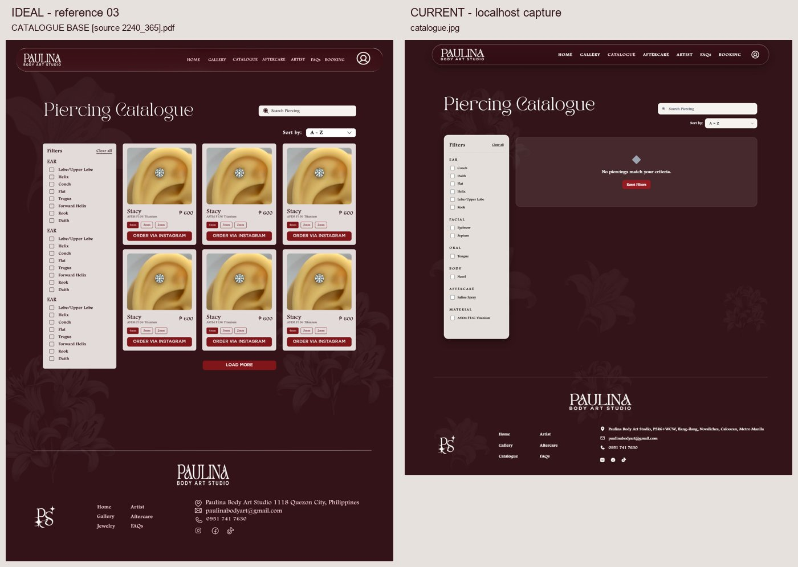
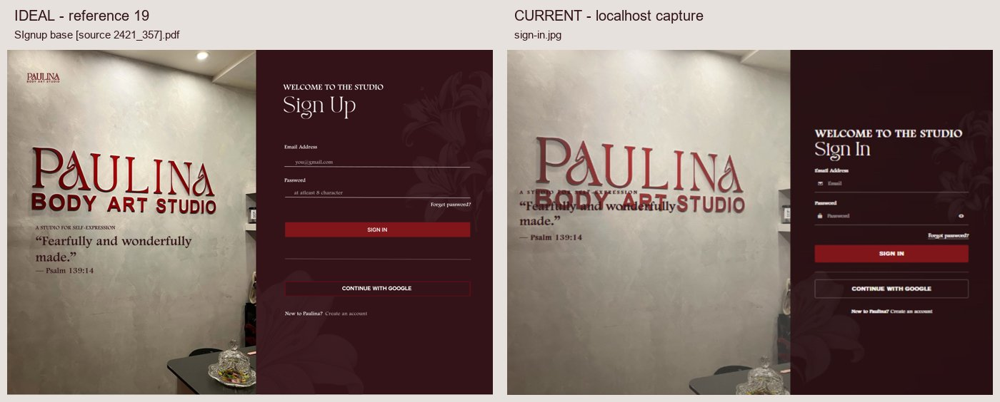

# Paulina Studio: local runtime, data, design and organization audit

Audit date: 13 November 2026, Asia/Singapore. Source baseline: `c547ce010536633bedb8caf5c3fab6144d5c29b7` on `main`. This audit is recorded on `codex/local-codebase-audit`.

## Assessment

The project starts successfully, but a successful page load does not establish a working booking or content-management system. The immediate catalogue/gallery symptom is reproduced: both public APIs return successful empty arrays, and the connected Supabase project's anonymous reads also return zero visible records. The local image files do not create database records automatically. Whether the hosted tables are actually empty, contain unpublished records, or hide records through RLS remains unresolved without trusted owner access.

There are more urgent problems than visual cleanup: private/admin Express handlers lack server authorization, and the checked-in consolidated SQL permits anonymous access to private records and content writes. These are source findings; this audit did not inspect or change deployed policies. Adding privileged server credentials before repairing authorization would increase the consequences of those gaps.

The visual identity and much of the public page structure already exist. Retain Express and vanilla HTML/CSS/JavaScript. Restore reliable data and error handling, then organize the existing domains and match the supplied finished designs. A framework rewrite would add migration work without resolving the underlying contracts.

## What was done

- Ran `npm ci`: 89 packages installed, 90 audited; the lockfile and dependency declarations were unchanged. Node `v24.21.0` satisfies the declared `>=22` requirement.
- Ran `npm start`; the app is available at [http://localhost:3000](http://localhost:3000). The startup reports Supabase storage and an unconfigured email provider.
- Reproduced missing content through the public HTTP endpoints and a repeatable count assertion; repeated the check with the same failing result.
- Queried counts only for public content tables using the app's existing public configuration. No customer bookings, receipts, tattoo references or private notifications were retrieved.
- Reviewed the server, stores, browser services/controllers, routes, migration source and setup documentation. An independent codebase auditor reviewed authorization and organization; an independent visual reviewer supplied a first pass, but its full review was interrupted by a usage limit. The parent completed the comparisons.
- Inspected the supplied ZIP as design evidence, not as instructions to execute. It has 49 PDF entries: 12 explicitly named wireframes, 32 finished design/brand references and five additional simplified admin exports excluded from design authority.
- Compared the finished references with public browser captures, source markup and isolated admin source previews. See [screen-by-screen audit](screens.md), [reference inventory](reference-index.json), and the comparison images linked below.
- Captured desktop at a 1440 x 1024 browser viewport to match the mostly 1440-pixel reference canvases. Spot-checked four public screens at 390 x 844; document width equalled viewport width in each. These are browser checks, not physical-device acceptance.

No application fixes, database/schema/policy changes, content imports, dependency upgrades, booking submissions, email sends, account changes, push or deployment were performed. Admin screenshots are explicitly marked **static source preview**: scripts and network connections were disabled in an audit-only local renderer. Blank chart/grid/list regions in those previews do not prove a live data defect. That renderer was kept outside the repository and stopped after capture.

Wireframe handling: the 12 named wireframes were excluded before content extraction. One additional, unlabeled simplified Custom Requests export appeared in an initial contact sheet; it was then excluded together with four other simplified admin exports. Their generated files/contact sheets were removed, and none informed design recommendations. The original ZIP was not changed. Finished-reference IDs preserve their initial inventory numbers, so some numbers are intentionally absent.

## 1. Why catalogue and gallery are empty

### Reproduced evidence

| Check | Observed result | What it establishes |
| --- | --- | --- |
| `GET /api/health` | HTTP 200, `success: true`, `storage: "supabase"` | Express is running; this endpoint does not query the content tables. |
| `GET /api/catalogue` | HTTP 200, `success: true`, `count: 0`, `items: []` | The public catalogue receives no products from Express. |
| `GET /api/gallery` | HTTP 200, `success: true`, `count: 0`, `images: []` | The public gallery receives no works from Express. |
| Anonymous `jewelry_catalogue` count | HTTP 200, count 0, no query error; also 0 with published/order query | No catalogue rows are visible to the key actually used by this checkout. |
| Anonymous `gallery_images` count | HTTP 200, count 0, no query error; also 0 with published/order query | No gallery rows are visible to the same key. |
| Anonymous compatibility table counts | `catalogue_items`: 0; `gallery_items`: 0 for minimal ID counts | The older table paths did not expose an alternative populated dataset in this check. |
| Browser | Catalogue shows “No piercings match your criteria” with no filters selected; both gallery tabs show no published works | The user's symptom is reproduced in the running UI. |

Ranked hypotheses tested: (1) no published content visible under current configuration, (2) upstream errors being converted to empty success, (3) browser/server or legacy/current table mismatch. The first explains the observed run. The second and third are genuine source risks but were not shown to cause this particular successful count-zero response. The legacy `gallery_items` published/order query returned HTTP 400; that table is not the primary `gallery_images` path, and the response did not provide a useful message. This does not establish why primary tables have zero visible rows.

### Actual read paths

```text
Catalogue page -> public/js/catalogue.js -> /api/catalogue
              -> services/catalogueStore.js -> jewelry_catalogue
              -> is_published = true, ordered by display_order

Gallery page  -> public/js/gallery.js -> browser Supabase gallery_images first
              -> /api/gallery only when direct query fails/is unavailable
              -> services/galleryStore.js -> gallery_images
              -> is_published = true, ordered by display_order
```

In gallery, an empty direct-query array is considered a successful result, so the API fallback is not consulted. A server `.env` override does not update the browser's configuration automatically. In a differently configured deployment, gallery and catalogue can therefore disagree even when both appear healthy.

Evidence: `public/js/catalogue.js:46-74`; `public/js/gallery.js:127-164`; `services/catalogueStore.js:148-169`; `services/galleryStore.js:139-158`; browser configuration in `public/js/supabase-config.js:4-44`.

### Contributing implementation problems

1. **A checkout is not a content/database export.** No `.env` was present in this checkout. Server stores and browser configuration independently fall back to a hardcoded hosted project. `public/assets/catalogue-images/` contains artwork, but neither the public loader nor the consolidated SQL imports those files as catalogue records. Gallery metadata is similarly hosted, not supplied by the ZIP's mockups.
2. **Failure and empty are conflated.** Both public stores return `[]` when Supabase reports an error. Express then emits `success: true`. The catalogue controller also displays an empty result when the API cannot be loaded. An outage or policy/schema error can look like a genuinely empty studio catalogue.
3. **The catalogue message is misleading.** “No piercings match your criteria” invites resetting filters even when there are no published records at all. Define separate initial-empty, filter-empty, loading and unavailable states.
4. **There are separate legacy tables.** `full_production_sync.sql` creates `catalogue_items` and `jewelry_catalogue`, plus `gallery_items` and `gallery_images`. They are physical tables, not aliases, with no content-copy/synchronization mechanism in that script. Pick canonical owners and migrate deliberately; do not guess which table should be deleted.
5. **Setup documentation is stale.** The gallery troubleshooting guide still describes a local JSON fallback and an admin-gallery page/controller that are no longer the current implementation. The existing snapshot script is marked deprecated and writes hosted content; it is not a safe, automatic gallery/catalogue restoration command.

### Smallest next investigation

After securing access, have the database owner compare total/published row counts under trusted access with anonymous published counts for `gallery_images` and `jewelry_catalogue`. Inspect applied RLS and grants, actual schema, storage objects and record image URLs. Check whether the studio's intended data lives in another Supabase project or an owner export. Restore approved records into a dedicated development dataset or the explicitly selected environment; verify record counts, media loading, visibility, order, search/filter and admin-to-public synchronization. Do not populate with mockup photos, invented prices or demo records and call that data recovery.

### Repeatable failing check

Run from the repository root while Express is running. It asserts the reported expectation that published content should be present; a legitimately empty new studio would intentionally fail it.

```powershell
node -e "(async()=>{const checks=[];for(const [path,key] of [['/api/catalogue','items'],['/api/gallery','images']]){const res=await fetch('http://localhost:3000'+path);const body=await res.json();const pass=res.ok&&body.success&&Array.isArray(body[key])&&body[key].length>0;checks.push(pass);console.log((pass?'PASS':'FAIL')+' '+path+' HTTP '+res.status+' published count='+body[key]?.length);}process.exitCode=checks.every(Boolean)?0:1})()"
```

Observed twice:

```text
FAIL /api/catalogue HTTP 200 published count=0
FAIL /api/gallery HTTP 200 published count=0
Exit code: 1
```



## 2. Prioritized engineering findings

Priority meanings: **P0** = secure before privileged configuration or external exposure; **P1** = repair before trusting core workflows; **P2** = resolve during the organized cleanup/design pass. Source findings identify code defects, not proof of deployed policy state or successful exploitation.

| ID | Priority | Finding, evidence and user impact | Required repair / acceptance |
| --- | --- | --- | --- |
| SEC-01 | P0 | No server authentication/authorization middleware protects private booking reads/changes, request decisions, notifications or `/api/admin/*`. See `server.js:109-173`, `885`, `969`, `1040`, `1084`, `1191`, `1468`, `1494`, `1763`, `1788`. Reachable handlers rely on whichever database credentials/policies happen to allow the operation. CORS does not protect against direct HTTP callers. | Verify user identity on the server and enforce trusted admin permissions on every private read/mutation; customer reads need ownership checks. Keep intended published-content reads public. Test anonymous, ordinary authenticated and admin roles. **Do not add a service-role key first.** |
| SEC-02 | P0 | Consolidated SQL grants anonymous booking/custom-request CRUD using unconditional policies, broad content writes and public storage access. See `docs/migrations/full_production_sync.sql:193-215`, `280-302`, `69-85`, `828-829`. Customer references may also use public URLs. | Inspect actual hosted policies read-only, then replace unsafe policies in a reviewed migration. Use private storage and authorized/signed access for sensitive attachments. Preserve existing files/records. This script must not be run wholesale to “fix missing data.” |
| SEC-03 | P0 | `is_studio_admin()` trusts `user_metadata.role`, which users can edit. See consolidated SQL `:27`; browser counterparts `public/js/admin-reviews.js:57-58`, `auth-callback.js:51-57`. | Authorize using trusted app metadata or a protected role table. UI redirects are not authorization. Check all role consumers; validate negative cases. Hosted helper installation was not verified. |
| DATA-01 | P1 | Empty anonymous content reads reproduce. Independent config fallbacks, separate compatibility tables and swallowed failures make diagnosis ambiguous. | Establish one project/table ownership map, explicit development setup and truthful response states, then restore approved data. See section 1. |
| DASH-01 | P1 | Dashboard HTML loads `admin-app.js` as a classic script (`html/admin-side/dashboard.html:316`), but the script contains a top-level import (`public/js/admin-app.js:28`). An isolated `vm.Script` parse reproduces `Cannot use import statement outside a module`. | Repair the script boundary and reconcile the duplicate controller, then verify dashboard initialization with a known development dataset. |
| DASH-02 | P1 | `admin-app.js:19-100` adds a second controller using `client_name`, `appointment_dt`, `total_price` and `payments`, conflicting with the established API engine below and the checked-in schema. | Do not stop at `type="module"`: remove/reconcile the added starter and retain the existing API engine's behavior. Verify KPI, feed, chart, filters and calendar links against canonical fields. |
| UPLOAD-01 | P1 | Booking reference/receipt uploads ignore returned Supabase `{ error }` before generating a public URL (`server.js:310-317`, `350-357`). | Check upload outcomes, propagate actionable errors and preserve already-saved bookings. Prove a failed upload cannot be reported as a successful attachment. |
| SAVE-01 | P1 | Request/notification stores return proposed records after failed persistence; request decisions can update related booking state despite request-update failure. See `services/customRequestStore.js:123-126`, `272-283`; `notificationStore.js:91-94`; `server.js:740-768`. | Return explicit errors/partial outcomes and make related decision state consistent. Keep a saved booking recoverable when queue/notification/email work fails. |
| CAL-01 | P1 | Calendar edit/cancel/delete changes the UI despite failed HTTP operations (`public/js/master-calendar.js:1080-1096`, `1110-1125`, `1133-1144`). | Apply confirmed results, show failure and preserve the previous appointment on rejection. Verify refresh yields the same state as the success UI. |
| BOOK-01 | P1 | Slot and retry-token checks occur before a separate save (`server.js:616`, `657`, `681`). The migration has a non-unique request-token index and no equivalent atomic active-slot rule. Availability errors return unlocked `[]` (`services/bookingStore.js:293-295`). | Canonicalize slots; add database-backed idempotency and transactional booking/slot protection. An availability outage must block scheduling rather than advertise free slots. Test concurrent requests. |
| BOOK-02 | P1 | Date/time/service input accepts nonempty free text (`server.js:425-462`, `1064-1069`) while collisions use string matching. | Validate authoritative service/artist/schedule values, studio timezone and valid future appointments at the API boundary. Keep client validation for usability. |
| DEPS-01 | P1 | `npm audit` reports one affected direct dependency, `nodemailer@7.0.13`, at high severity. The suggested release is a major upgrade (`10.5.0` at audit time). | Review applicable advisories and upgrade with focused email compatibility checks. No exploit was demonstrated; no `npm audit fix --force` was applied. |
| OPS-01 | P1 | Local email is unconfigured. Running the site cannot establish delivery of customer confirmations or admin decisions. | Configure a selected development email destination/provider after the data boundary is secure, then explicitly authorize and exercise delivery cases. Never mark an appointment confirmed solely because email settings exist. |
| MONEY-01 | P2 | Booking normalization defaults missing amounts/status to a paid deposit; dashboard “Deposits collected” uses confirmed count x 500 while the chart uses amounts (`services/bookingStore.js:64-67`, `100-103`; `public/js/admin-app.js:672-677`). | Define verified deposit semantics and derive all financial views from the same evidence. Retain intentional manual revenue entry. |
| SAVE-02 | P2 | Booking update/delete returns success without verifying affected rows (`services/bookingStore.js:242-276`). | Distinguish changed, not found, forbidden and upstream failure. An RLS-filtered no-op must not be presented as saved. |
| POLICY-01 | P2 | Home says clients under 15 may attend with guardian consent (`html/user-side/home.html:134`), but booking enforces minimum 18 (`public/js/booking.js:219-220`). | Obtain the studio's actual age policy and align published copy, consent handling and API validation. Do not silently choose a policy during cleanup. |

The server starts with `app.listen(port)` without a loopback host (`server.js:2129`), so it is not explicitly restricted to localhost. Actual network reachability depends on the host/firewall. Do not share a tunnel or expose it as a review environment before SEC-01 is addressed.

## 3. Design comparison conclusions

The supplied finished designs are the target. Keep the burgundy/cream identity, supplied logo assets, floral language, TAN Pearl/Footlight/Couture families and existing functional requirements. The reference brand sheet specifies `#80151A`, `#F6F2F0`, `#F6D0D6`, `#600A2E`, `#331418`; related tokens already exist in `public/css/header_and_footer.css:8-28`. Font redistribution permissions are not established by this audit; no new fonts were installed.

The [complete matrix](screens.md) records all 32 finished references, including modal variants and the brand sheet, and identifies implementation screens with no finished reference. Seventeen [comparison images](comparisons/) place the ideal next to the current capture at equal widths; heights are not stretched to create an artificial match. Reference sample content is not production truth.

The most consequential visual gaps are:

1. **Catalogue/gallery are content-blocked.** Empty states replace the reference's three-column product grid and large numbered portfolio mosaics. Their populated cards/lightboxes cannot be visually accepted until approved records and images are available.
2. **Auth artwork duplicates text.** The studio wall photo already carries branding/verse artwork, while live text overlaps it. Both sign-in and create-account visibly collide. Retain one readable treatment, then match the reference's panel split, crop, form position and lighter text hierarchy. The reference named “SIgnup” actually contains a sign-in form and inconsistent heading; keep the correct functional labels.
3. **Typography/spacing differs across pages.** Body and navigation text are often heavier than the mockups. Reviews and profile use decorative serif headings where the additional reworked PDFs use simpler sans headings. The FAQ title wraps to two lines at desktop while the reference keeps it on one line. Shared token changes must not erase intentional page-specific treatment.
4. **Booking is narrower and displaced by a policy panel.** A live “Before you book” block on every step adds substantial height absent from the mockups. Keep essential policy information, but integrate it without pushing the primary card so far down. Preserve the four-step flow, upload guidance and truthful pending-confirmation language.
5. **Admin management uses a different composition.** References show direct Gallery/Catalogue/Hero sidebar items and persistent right-hand inspectors. The current unified Edit Website shell uses section navigation and sheet/modal editing. The choice needs a deliberate adaptation plan: reuse its existing controller logic and routes while restoring the reference's desktop hierarchy, rather than recreating another management implementation.
6. **Reviews lacks the reference's summary.** CSS exists for rating summary elements but current markup/controller do not render the average/total summary shown in the later PDF. Two public cards were visible during this audit; five sample reference cards are not a requirement to fabricate reviews.



Public browsing screens were inspected in a real browser. Long pages were scrolled and recaptured where initial reveal/lazy-loading hid images; initial blank regions on home/create-account were not reported as data loss. The home map was blank in the captured browser; separate third-party map/network verification is needed. The aftercare page's document title incorrectly says “FAQs.”

## 4. Organize the codebase while fixing it

### Existing architecture and reuse inventory

| Area | Current owner | Keep / improve / replace / remove |
| --- | --- | --- |
| Entry and routing | `server.js`, about 2,192 lines | KEEP entrypoint and URLs. IMPROVE by extracting existing route domains after behavior is baselined. |
| Persistence | `services/{bookingStore,customRequestStore,galleryStore,catalogueStore,notificationStore}.js` | KEEP domain ownership. IMPROVE shared configuration, field normalization, errors and affected-row checks. |
| Public content | `public/js/site-content.js`, page controllers, browser Supabase services | KEEP functional content binding. IMPROVE published-read ownership and loading/error contracts. |
| Admin CMS | `public/js/admin-editweb.js`, about 4,514 lines | KEEP existing editing capabilities. Split by actual sections and share its proven utilities; avoid a second CMS. |
| Browser API URLs | `public/js/api-base.js`; other hand-written resolvers | KEEP and reuse existing helper. Consolidate callers, including standalone admin catalogue and dashboard/calendar helpers. Preserve Live Server and same-origin behavior. |
| Shared UI | header/footer loader and styles, `public/components/dialog.js`, `notice.js`, `admin-sheet.js`, `admin-nav.js` | KEEP and reuse. Admin navigation already has disclosure keyboard behavior. Consolidate duplicated shell markup/tokens after visual baselines. |
| Account services | shared account settings, auth/profile/review/storage services | KEEP current contracts. IMPROVE server/RLS authorization independently of client identity display. |
| Root `js/supabase-config.js` | Stale self-import/duplicate declaration | REMOVE only after updating references/docs. Express `/js` serves `public/js`, not this folder. |
| Templates / previews | `template/`, `html/admin-side/_sheet-preview.html` | Review callers, then exclude developer previews from production discovery. Do not delete by filename alone. |
| Setup docs / SQL | `others/README.md`, `docs/*`, unversioned applied migration state | REPLACE outdated onboarding guidance; record canonical schema and applied-policy provenance. Retain historical evidence with labels. |
| Dependencies / tools | Express, Supabase, Multer, Nodemailer, Resend; no test/lint/CI setup found | KEEP stack. Add only focused checks needed by repairs; upgrade the flagged mail dependency deliberately. |

Free compatible component discovery started with local components, as required. Existing dialogs, sheets, notices, navigation and ordinary form controls cover the proposed fixes. No external component library, new UI dependency or framework is justified for this audit/plan. A later component need should be evaluated against exact compatibility/license/accessibility requirements before installation.

### Minimal target structure

```text
server.js                        # composition, startup, static routes
routes/
  bookings.js
  custom-requests.js
  gallery.js
  catalogue.js
  notifications.js
services/                        # keep existing domain stores and email service
  shared Supabase/config boundary
public/js/
  existing public page controllers and shared services
  admin-editweb/                 # section modules only where the current file needs splitting
public/css/
  shared brand tokens and shells, then existing page styles
html/user-side/                  # keep URLs and page ownership
html/admin-side/
docs/
  setup, data ownership, migrations, verification and this audit
```

Do not create each folder/module in advance. Extract one domain during the corresponding repair, preserve its public interface, and check its callers before moving the next. Avoid renaming every file, deleting assets or merging compatibility tables in the same commit as a behavior repair.

### Contracts that must survive

- Published status, category, display order, media URL and body-part/size metadata must agree between editing and public reads.
- Public booking submission creates a pending request; studio acceptance and customer confirmation remain distinct events.
- Retry/recovery must not duplicate a booking. Email failure must not erase a saved booking or recorded decision.
- Do not turn a manually entered revenue figure, uploaded receipt or default amount into verified payment.
- Keep keyboard modal navigation, focus restoration, Escape, scroll locking, menu disclosure and responsive fallbacks.
- Preserve current URLs/aliases while reorganizing; clean URLs and `/html/...` paths currently coexist. Explicitly handle the public/admin catalogue filename collision.
- Preserve existing records and attachments during schema/storage migration; no deletion based only on a missing graph/caller match.

## 5. Recommended repair sequence

| Phase | Concrete scope | Completion evidence | Dependencies / boundary |
| --- | --- | --- | --- |
| 1. Secure and identify data | Map project/table/bucket ownership; inspect applied schema/RLS read-only; protect all private/admin APIs; replace editable metadata roles; document development configuration. | Role-based denial/allow checks; public published reads still work; private storage access is controlled; owner-backed source inventory. | First. Privileged credentials and data restoration must follow authorization, not precede it. Applying hosted SQL is a separate concrete change. |
| 2. Restore truthful content | Fix upstream failure contracts, select canonical gallery/catalogue paths, distinguish empty/filter/error, restore approved development records/media, fix dashboard module/duplicate controller. | Original content assertion passes on approved records; zero/hidden/error cases remain truthful; dashboard initializes; admin publish/hide/order matches public output. | Requires phase 1 and an owner-selected content source. Keep presentation stable while repairing data. |
| 3. Repair booking reliability | Canonical schedule validation, atomic slots/retries, checked uploads, consistent request decisions, affected-row checks, truthful calendar saves and deposit semantics. Upgrade flagged mail dependency and verify configured delivery separately. | Failure-path and concurrency checks; refresh-persistent changes; attachment/error cases; no premature confirmation; approved email delivery evidence. | Use isolated development data; destructive/customer actions need deliberate test records. |
| 4. Extract repaired domains | Move route domains out of server.js, share server config/API URL helper, split CMS sections, update imports/docs, exclude developer previews. | Same route/action behavior before and after each move; focused regression checks; no duplicate configuration owners. | Small commits alongside phases 2/3 where a clean seam already exists; no wholesale rename. |
| 5. Match finished mockups | Catalogue/gallery first; auth and public reading pages next; booking and admin afterward. Align shared typography, spacing, inspector layout, modal states and data summaries. | 1440-wide comparisons against each finished reference, responsive captures, populated/empty/error states, keyboard checks and owner review. | Populated content screens require phase 2. Preserve policy/auth/accessibility behavior while adapting design. |
| 6. Retire duplicates and document | Remove proven unused config/templates/legacy paths, decide compatibility-table migration, add accurate root setup instructions and scoped automated checks. | Reference/caller sweep, reviewed deletion manifest, working onboarding on a clean checkout, no secrets/data in Git. | Delete only after ownership and migration decisions are established. |

The first repair slice should be **server authorization + a read-only owner data inventory + truthful public content diagnostics**. It makes the next decision concrete: recover records, repair RLS/project selection, or import approved content. Styling changes alone cannot establish that catalogue/gallery are fixed.

## 6. Decisions and access needed for implementation

1. Which Supabase project and content export are authoritative, and may a dedicated development copy be created?
2. Which trusted accounts/roles administer the studio? What can ordinary customers read/change?
3. Which finished reference variants govern reviews and profile typography? Recommended provisional visual targets are the explicitly named reworked review/profile PDFs; preserve older variants in the matrix until the owner chooses.
4. Should the unified Edit Website navigation remain while its desktop editors match the reference inspectors? Recommended: reuse the unified implementation and adapt its composition.
5. What is the actual minimum age, booking window, studio timezone, cancellation policy and verified-deposit definition?

These are future implementation inputs, not requests to block this audit. Credentials should be configured privately, not pasted into the audit or committed.

## Verification limits

- The HTTP symptom and classic-script parse failure are reproduced. Other defects are tied to source evidence and need focused regression checks when repaired.
- No authenticated admin/customer session was available or used. No private data/API mutations, hosted RLS inspection, live uploads, payment actions, booking submission, account creation, email delivery or calendar write was exercised.
- Admin previews establish markup/CSS composition only. Gallery/catalogue lightboxes and final booking receipt states received source comparisons because live content/submission was unavailable or out of audit scope.
- Four mobile browser spot checks had no measured horizontal overflow, but interactions across all mobile screens, assistive technology, zoom and physical devices remain unverified. There are no mobile designs in the selected references.
- No unit/integration test suite, lint configuration or CI pipeline was present. The email test script sends email and was not used as a regression check. `npm ci`, HTTP checks, the isolated parser check and browser observations are the checks performed.
- The app's hardcoded remote project fallback means this local server is not an isolated local database. No hosted writes were made.
- Dependencies installed successfully; the Nodemailer advisory remains unresolved. No push or deployment occurred.

## Evidence index

- [All finished-reference mappings and screen findings](screens.md)
- [Archive filename inventory with exclusions](reference-index.json)
- [Sanitized runtime/check results](evidence.json)
- [Desktop and mobile screenshots](screenshots/)
- [Seventeen ideal/current comparisons](comparisons/)
- [Finished design contact sheets](references/)

Original screenshot/PDF-render intermediates remain in the machine-local folder `C:/Users/Admin/.codex/tmp/paulina-audit-2026-11-13`. Committed screenshots are compact copies, normally 1100 pixels wide for desktop, of captures made at the stated viewport. Static previews have a visible audit label. Mockup sample records and static preview zero values are never evidence of real studio data.
